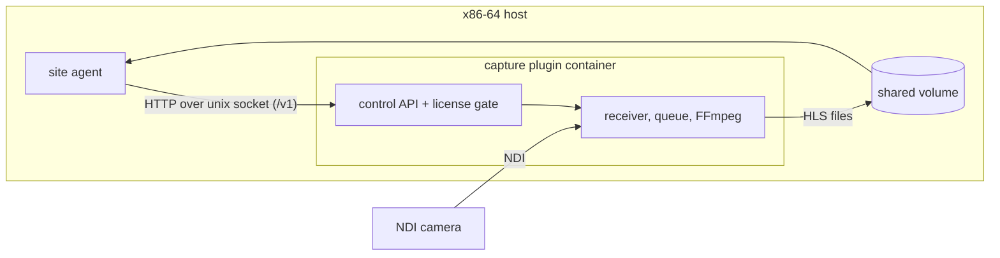

# mynextscreen capture plugin

An NDI®-compatible capture plugin for [mynextscreen](https://github.com/Flo-Schilli/mynextscreen) site agents. It receives video from an NDI camera, encodes it to H.264 and writes Short-HLS (1 s segments) to a shared directory. A local control API on a unix socket starts and stops streams.

The plugin is a separate program with its own license. The site agent contains no NDI code and no NDI binaries. The two exchange plain JSON over a socket and HLS files on disk.

NDI® is a registered trademark of Vizrt NDI AB. https://ndi.video

## Supported platform

**x86-64 general-purpose Linux only.** The operator must be able to freely change the operating system and run third-party software on the host. The NDI SDK License Agreement excludes fixed-purpose appliances, fixed-purpose virtual or cloud environments and embedded hardware (clause 1b). Do not run the image there.

- Only `linux/amd64` images are published.
- An arm64 image can be built locally for development tests. It refuses to run unless `MNS_CAPTURE_DEV_ALLOW_ARM=1` is set (the plugin then logs a loud warning). It is never published and not supported in production.
- The `h264_v4l2m2m` encoder (Raspberry Pi) stays in the code for internal development tests. It is not a supported path.

## How the agent talks to it



- **Control API:** HTTP/1.1 over the unix socket `MNS_CAPTURE_SOCKET` (default `/run/mns-capture/plugin.sock`). The socket directory is created with mode 0700 and the plugin refuses a symlinked or foreign-owned directory. Both containers run as the same uid, so filesystem permissions are the authentication.
- **Contract:** [`openapi.json`](openapi.json) (OpenAPI 3.1). The specs validate every handler response and request against it, so code and contract cannot drift. `apiVersion` in `GET /v1/status` is the major version of the contract.
- **HLS output:** `MNS_CAPTURE_HLS_DIR/<streamId>/index.m3u8` (default `/var/lib/mns-capture/hls/<streamId>/`). Segment names carry a per-run id, so a restart never overwrites a segment that the previous playlist still lists.

| Route                           | Purpose                                                                                           |
| ------------------------------- | ------------------------------------------------------------------------------------------------- |
| `GET /v1/status`                | state, versions, shipped license reference, architecture, usable encoders                         |
| `PUT /v1/license`               | accept `{ sdkVersion, licenseSha256 }`; must match the shipped text exactly                       |
| `DELETE /v1/license`            | revoke the acceptance and stop all streams                                                        |
| `GET /v1/license/text`          | the shipped NDI SDK license text and the plugin terms                                             |
| `PUT /v1/streams/:streamId`     | start a stream, or replace it when the config changed (idempotent). `streamId` is a UUID           |
| `DELETE /v1/streams/:streamId`  | stop a stream and remove its HLS directory                                                        |
| `GET /v1/streams`               | per-stream status: `state`, `sourceName`, `encoder`, `fps`, `framesDropped`, `error` code         |

Request bodies are JSON, limited to 16 KiB, and validated strictly: unknown fields are rejected. A stream config looks like this:

```json
{
  "cameraHost": "192.168.1.60",
  "ndiSourceName": null,
  "bandwidth": "highest",
  "width": 1280,
  "height": 720,
  "fps": 30,
  "bitrateKbps": 3000,
  "encoderPref": "auto"
}
```

The camera is found by address only: `cameraHost` is handed to the NDI finder as an extra IP, no mDNS discovery runs. The output never exceeds the source resolution or frame rate. Without a frame for 10 s, or after an FFmpeg exit, the pipeline restarts itself with backoff.

## States and license acceptance

| State              | Meaning                                                                                  |
| ------------------ | ---------------------------------------------------------------------------------------- |
| `license_required` | No valid acceptance. The NDI library is not loaded and `PUT /v1/streams/...` answers 409. |
| `ready`            | Accepted and the NDI runtime loaded. Streams may run.                                    |
| `error`            | `errorCode` says why: `runtime_missing` or `ndi_load_failed`.                            |
| `incompatible`     | Unsupported platform (`errorCode: unsupported_platform`).                                |

The image ships the NDI SDK license text of the bundled runtime. Its SHA-256 is reported in `GET /v1/status` as `license.licenseSha256`. Accept it in one of two ways:

1. **API:** `PUT /v1/license` with the `sdkVersion` and `licenseSha256` from the status. A hash that does not match the shipped text is refused with 409. The acceptance is stored in `MNS_CAPTURE_STATE_DIR`.
2. **Environment:** set `MNS_CAPTURE_ACCEPT_NDI_LICENSE=<licenseSha256>`. Having to paste the hash makes the operator look at the exact license version. A bare `true` is not accepted. An acceptance through the environment cannot be revoked through the API.

When the runtime is updated and the license text changes, its hash changes and every earlier acceptance becomes invalid: the plugin returns to `license_required` until the new text is accepted. Nothing accepts a license on anyone's behalf.

## Run

```bash
docker run -d --name capture-plugin --network host --user 1000:1000 \
  -v /srv/capture/run:/run/mns-capture \
  -v /srv/capture/state:/var/lib/mns-capture/state \
  -v /srv/capture/hls:/var/lib/mns-capture/hls \
  ghcr.io/flo-schilli/mynextscreen-capture-plugin:latest
```

Host networking gives the plugin LAN access to the camera's NDI ports. For the hardware encoder, pass `--device /dev/dri` (VA-API needs a driver on the host; without one the plugin uses libx264). The container runs as the unprivileged user `node` (uid 1000) and works with a read-only root filesystem plus tmpfs for `/tmp`.

| Variable                         | Default                         | Purpose                                                          |
| -------------------------------- | ------------------------------- | ---------------------------------------------------------------- |
| `MNS_CAPTURE_SOCKET`             | `/run/mns-capture/plugin.sock`  | control API socket                                               |
| `MNS_CAPTURE_HLS_DIR`            | `/var/lib/mns-capture/hls`      | HLS output; emptied at start                                     |
| `MNS_CAPTURE_STATE_DIR`          | `/var/lib/mns-capture/state`    | stored license acceptance                                        |
| `MNS_CAPTURE_ACCEPT_NDI_LICENSE` | unset                           | accept the license on the device: the `licenseSha256` to accept  |
| `MNS_CAPTURE_DEV_ALLOW_ARM`      | unset                           | `1` allows running on a non-x86-64 host (development only)       |
| `MNS_CAPTURE_ENCODER`            | unset                           | force one encoder (`libx264`, `h264_vaapi`)                      |
| `MNS_CAPTURE_FFMPEG_PATH`        | `ffmpeg`                        | FFmpeg binary                                                    |
| `MNS_CAPTURE_LOG_LEVEL`          | `info`                          | `debug`, `info`, `warn`, `error`, `silent`                       |

## Development

Node 26 and the npm pinned in `package.json` (12.2.0). The host Node version does not matter if you work in a `node:26` container.

```bash
npm ci
npm run lint && npm run format:check && npm run typecheck
npm test            # Jest with a coverage gate of 85/75/83/85
npm run build
docker build -t mns-capture-plugin:dev .
scripts/smoke-image.sh mns-capture-plugin:dev
```

The specs never load `grandi`: it sits behind a seam in `src/pipeline/grandi-binding.ts`. FFmpeg is replaced by a fake process.

Layout:

- `src/pipeline/`: NDI receiver, bounded drop-oldest queue, FFmpeg transcoder and arguments, encoder selection, pipeline loop
- `src/api/`: unix-socket server, router, request validation
- `src/license/`: license gate, runtime info, acceptance store, platform check
- `src/streams/`: registry of running pipelines
- `openapi.json`, `ndi-runtime.json` (pins the bundled runtime), `scripts/` (image smoke test, NDI SDK denylist)
- `tools/ndi-test-source/`: a fake NDI camera for development ([README](tools/ndi-test-source/README.md))
- `tools/ndi-spike/`: a receive, encode and HLS benchmark script ([README](tools/ndi-spike/README.md))

### End-to-end test without a camera

```bash
docker build -t mns-ndi-test-source tools/ndi-test-source
docker run -d --name ndi-src --network host --entrypoint node mns-ndi-test-source sender.mjs
docker run -d --name capture-plugin --network host -e MNS_CAPTURE_ACCEPT_NDI_LICENSE=<sha256 from ndi-runtime.json> \
  mns-capture-plugin:dev
```

Then `PUT /v1/streams/<uuid>` over the socket with `cameraHost` set to the host's LAN IP. Never run the test source on a venue network.

### Updating the NDI runtime

The NDI SDK License requires the plugin to ship the latest SDK version (clause 2b). A weekly workflow (`sdk-watch`) compares the latest `grandi` release and the NDI SDK download headers with `.github/sdk-watch.json` and opens an issue when they change. To update:

1. Bump `grandi` and regenerate the lockfile in a `node:26` container with npm 12.2.0.
2. Update `ndi-runtime.json` (`grandi` version, SDK version, `libndiSha256`, `licenseSha256`). `src/runtime-manifest.spec.ts` and the image smoke test fail until it matches.
3. Update `.github/sdk-watch.json`.
4. Release. If the license text changed, administrators must accept the new text.

### NDI SDK material never enters the repository

The SDK, its headers and its documentation are Confidential Information under clause 3a of the NDI SDK License Agreement. `.gitignore` excludes them, `scripts/denylist.sh` fails CI on the tracked tree and on every file touched by a pull request, and the image smoke test checks that the built image holds exactly the pinned `libndi.so.6` (from the `@grandi/linux-x64` npm package) and no headers or SDK docs.

## Licensing

- **Plugin source code:** Apache License 2.0, see [LICENSE](LICENSE).
- **NDI runtime:** the image bundles the unmodified NDI runtime (`libndi.so.6`) from the `@grandi/linux-x64` package. It is distributed under the NDI SDK License Agreement, which must be accepted before the plugin runs (see above). The conditions NDI requires of distributions of this plugin are in [NOTICE](NOTICE). The NDI license text and `libndi_licenses.txt` ship in `/usr/share/licenses/capture-plugin/`.
- **FFmpeg:** a minimal build with libx264 under the GPL. It is a separate program started as a child process. The license texts and the exact source reference are in `/usr/share/licenses/ffmpeg/`, the build recipe is the `Dockerfile`.
- **grandi:** Apache-2.0.

"NDI®-compatible" only states that the plugin works with NDI products. It is not an NDI product and is not sponsored by NDI. NDI® is a registered trademark of Vizrt NDI AB. https://ndi.video
